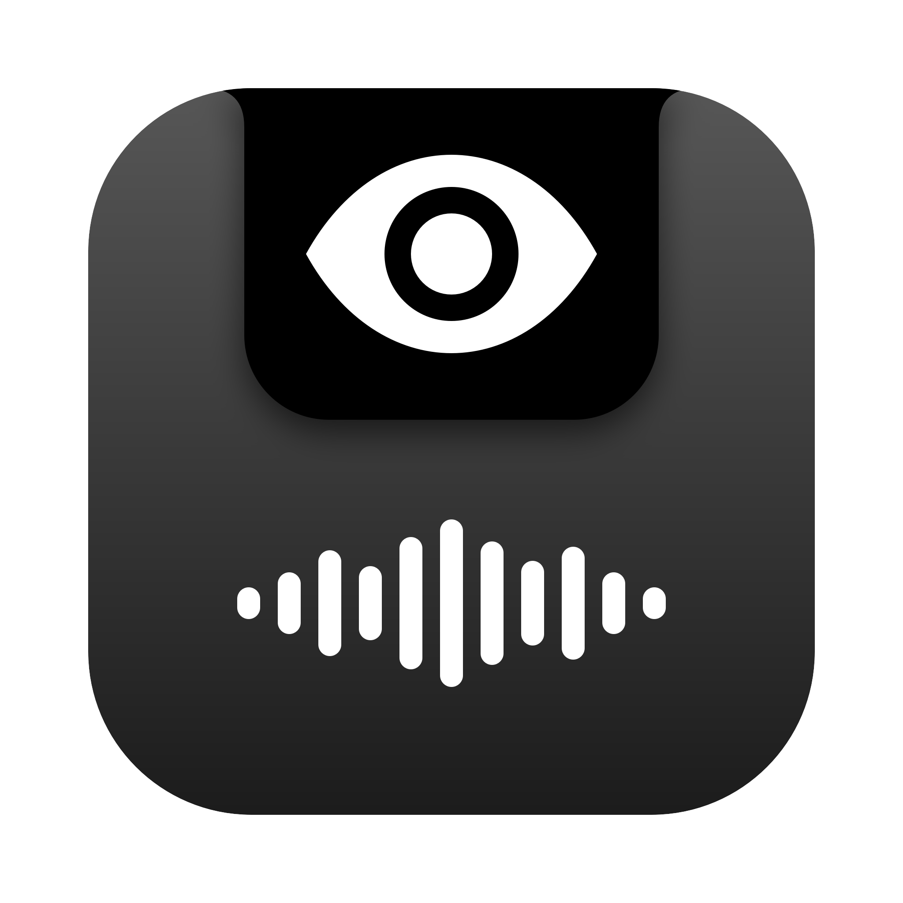

<p align="center">
  
</p>

<h1 align="center">Cadence</h1>

<p align="center">
  A teleprompter in your MacBook's notch that scrolls at the pace you speak.
</p>

<p align="center">
  
  
  <a href="https://github.com/nicholastn1/cadence/actions/workflows/ci.yml"></a>
  <a href="LICENSE"></a>
</p>

---

Cadence puts your script just under the camera, so on a call or a recording you look at the lens while you read. The text sits in a black panel that grows out of the notch, and it can follow your voice: it scrolls while you talk and waits when you stop.

> **Work in progress.** Cadence is young and changing quickly. It works on a daily-driver Mac, but expect rough edges. Bug reports and ideas are very welcome.

## Features

- **Lives in the notch.** The panel springs out of the hardware notch and tucks back in, shaped like the notch itself. With **Open on hover**, it stays hidden until you point at it or start reading.
- **Follows your voice.** Speech recognition runs on your Mac. Cadence finds where you are in the script and keeps that line under the camera. It handles numbers ("42" or "forty-two"), words you add or skip, and small mishearings. If you pause, it waits; if you go back, it follows.
- **Hidden from screen sharing.** People on Zoom, Meet, or Teams don't see it, and it doesn't show up in screenshots.
- **A script library.** Keep as many scripts as you like. Everything saves as you type.
- **Formatting for reading aloud.** Stress words with `**bold**`, highlight with `==amber==`, and leave yourself `[notes]` that show in red and are never read.
- **Countdown and mirror mode.** A 3-2-1 before scrolling starts, and mirrored text for teleprompter glass.
- **In the menu bar.** Play, switch scripts, or turn on your voice without opening the window. You can hide the icon.
- **Tells you about updates.** A daily check, release notes inside the app, and one-click updates for Homebrew installs.
- **Adjustable.** Panel width, visible lines, text size, speed, and which display to use.
- **Works with more than English.** Voice mode detects the script's language, so a Portuguese script works on a Mac set to English.

## Install

### Homebrew (recommended)

```sh
brew install --cask nicholastn1/tap/cadence
```

### Manual

Download `Cadence-x.y.z.zip` from [Releases](https://github.com/nicholastn1/cadence/releases), unzip it, and move `Cadence.app` to Applications.

Cadence isn't notarized yet, so the first time you open it macOS may block it. To allow it, go to **System Settings → Privacy & Security → Open Anyway**, or run:

```sh
xattr -dr com.apple.quarantine /Applications/Cadence.app
```

Homebrew does this step for you.

### Updating

Cadence checks for new versions once a day and tells you in the sidebar and the menu bar. Open **Cadence > Check for Updates…** to check now. If you installed with Homebrew, **Update and Relaunch** does the rest. You can also run:

```sh
brew upgrade --cask cadence
```

**Cadence > What's New** shows the release notes for every version.

### Build from source

```sh
git clone https://github.com/nicholastn1/cadence && cd cadence
./build.sh && open Cadence.app
```

You need macOS 14 or later and the Command Line Tools. Xcode isn't needed.

## Usage

| Action | How |
|---|---|
| Play or pause | ⌘↩, the play button, or click the notch panel |
| Back to the top | ⌘R |
| Follow my voice | ⌘L, or the microphone button |
| Faster or slower | ⌘] and ⌘[, or the speed slider |
| Scroll by hand | Trackpad over the notch panel |
| New script | ⌘N |
| Stress, highlight, note | ⌘B, ⇧⌘H, ⌘K (or the toolbar) |
| Settings | ⌘, |

Formatting in a script:

```text
We grew **42 percent** this year. [pause]
==Thank the team== before the numbers. [smile]
```

The first time you use voice mode, macOS asks for Microphone and Speech Recognition access.

## Requirements

- An Apple Silicon Mac with macOS 14 (Sonoma) or later.
- A notch is recommended. Without one, Cadence still shows as a panel at the top center of the screen.

## Privacy

Speech recognition runs on your Mac whenever macOS supports it for the script's language. Cadence has no servers, accounts, or analytics. Your script is stored only in the app's preferences on your Mac.

## Roadmap

Cadence is a work in progress. Next up, roughly in order. Want one sooner? Open an issue or upvote one.

- [ ] Signed and notarized builds
- [ ] Highlight the exact word you're on, not just the line
- [ ] Import scripts from `.txt`, `.md`, and `.docx` files
- [ ] Pace stats after a take: words per minute and where you slowed down
- [ ] Use your iPhone as a remote
- [ ] Portuguese and Spanish interface

Done recently: notch hover, script library, formatting, countdown, mirror mode, fuzzy voice matching, settings, menu bar, external displays.

## Contributing

See [CONTRIBUTING.md](CONTRIBUTING.md). The whole app is one Swift file, so it's easy to find your way around.

## License

[MIT](LICENSE) © Nicholas Nogueira
